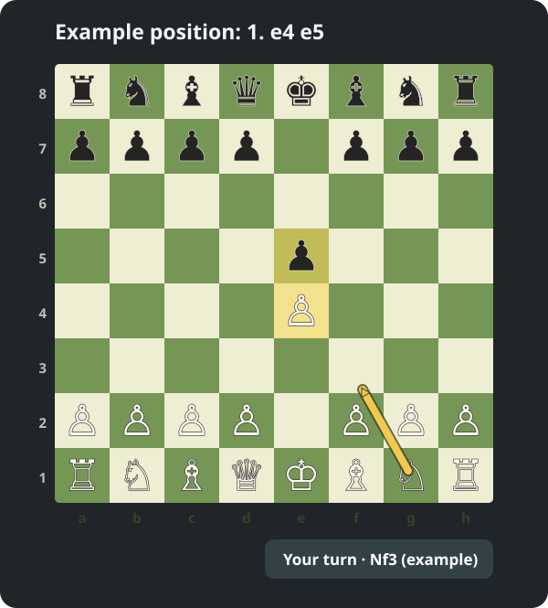

# ChessLens for macOS

ChessLens is a local chess study assistant for macOS. Select a board on your screen, confirm the position, and it draws an arrow for a move suggested by the bundled Stockfish engine. After you move, ChessLens watches the same board and suggests your next move when the opponent has replied.



*Illustrative example: after `1. e4 e5`, White could play `2. Nf3`; the arrow goes from g1 to f3. ChessLens analyzes the position you confirm, so its actual suggestion may differ.*

## Why use it?

- See a suggested move on the board instead of translating chess notation into screen coordinates.
- Follow a study game with one board selection: the arrow hides while pieces move, then returns after the position settles. ChessLens can recover your move and an immediate opponent reply even if it missed the intermediate frame.
- Review uncertain piece recognition in the editor. Locally saved piece shapes reduce repeated entry for a familiar board theme.
- Keep screenshots and analysis on your Mac. The app does not upload the board.

ChessLens is intended for study and offline practice. Check the rules of any chess service before using assistance during a game.

## Requirements and installation

- macOS 14 or later.
- Xcode with Swift 6.1 or later, or the matching Xcode Command Line Tools, to build from source.
- [Stockfish](https://formulae.brew.sh/formula/stockfish), available through Homebrew or as a local executable.
- Screen Recording permission to capture the board. ChessLens only requests the selected board area.

Download this repository from GitHub (**Code → Download ZIP**) and extract it. In Terminal, install Stockfish, change into the extracted project folder, and run:

```sh
brew install stockfish
./scripts/build-app.sh
open dist/ChessLens.app
```

If Stockfish is already installed elsewhere, set `CHESSLENS_STOCKFISH_BIN` to its executable path before running the build script. The build creates `dist/ChessLens.app`, copies Stockfish into it, and signs it locally. The Stockfish executable is not stored in this repository because it exceeds GitHub's per-file size limit. You can move the finished app to `/Applications`. If an older ChessLens is running, quit it first from its menu-bar icon, then open the new copy. If macOS blocks the first launch of a downloaded app, use Finder's **Open** action and follow the system prompt.

On the first capture, enable ChessLens in **System Settings → Privacy & Security → Screen & System Audio Recording**. Quit and reopen ChessLens after changing this permission.

## How to use

1. Press **⌘⇧8** and drag around the complete square board. Select only the board, with all 64 squares visible.
2. Review the proposed piece badges. Correct any orange **?** square by choosing a piece and clicking it; right-click the square to confirm that it is empty. Select your color, board orientation, and whose turn it is. A screenshot alone cannot determine the turn or castling history. Paste an accurate FEN when those details matter. Use **Start position** only when the screen actually shows the starting position.
3. Tick the confirmation box and choose **Analyze and show arrow**. If it is your opponent's turn, ChessLens waits instead of suggesting a move for them.
4. Play your move. ChessLens monitors the selected area, waits for two continuous quiet seconds after visible movement, and analyzes when it is your turn again. The status bar stays available while it waits.

During a session, press **⌘⇧8** or **↻** to refresh the same board. Choose **Hide suggestion** to hide the arrow while monitoring continues. Use **Stop automatic watch** or the bar's **×** to end monitoring. To select a different board area, choose **Select chessboard** from the menu-bar icon.

If the scan cannot identify a piece confidently, the editor asks you to review it. **Save piece shapes only** teaches that theme without starting analysis. The reference shapes for one common theme are included locally; your confirmed samples stay on your Mac. **Reset visual learning** removes your samples but retains the built-in set.

## Limits and verification

Automatic recovery covers up to two moves between verified captures. If the board moves on screen, the theme changes, several moves are missed, or a piece is obscured, select or confirm the board again. Recognition scores are not guarantees of correctness. Always check the proposed position before analysis, particularly on an unfamiliar theme.

Run the local tests with:

```sh
swift test -c release --disable-sandbox
```

The [scanner comparison](benchmarks/scanner-2026-09-28.md), [appearance benchmark](benchmarks/vision-2026-09-28.md), and [move-recovery benchmark](benchmarks/reconciliation-2026-09-27.md) give measured results and their limits. They do not measure a full live game.

## License and engine

The build copies an unmodified Stockfish binary from your local installation. Stockfish is licensed under GPLv3; its license and source information are in `ThirdParty/Stockfish` and in the built app under `Contents/Resources/Stockfish-*`. ChessLens uses Stockfish for move suggestions and its internal engine as a fallback.
